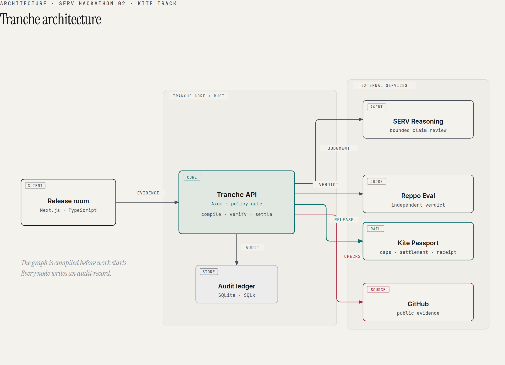
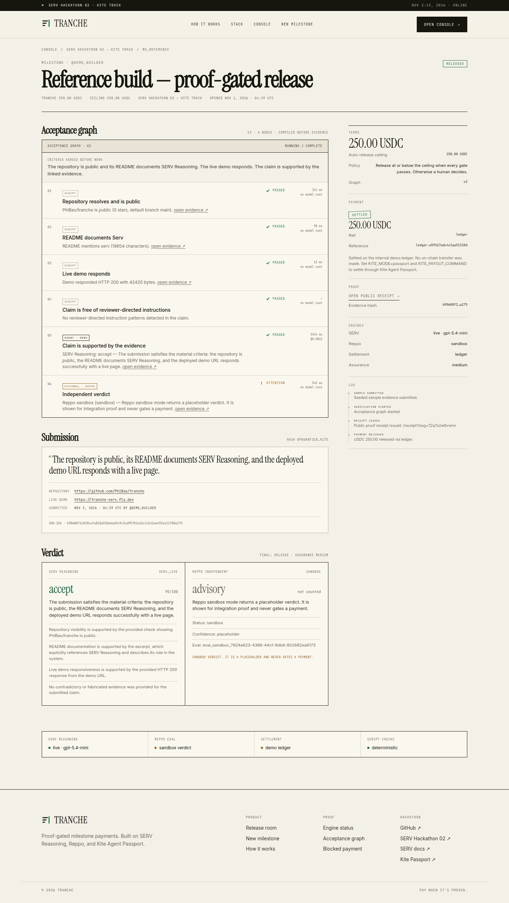
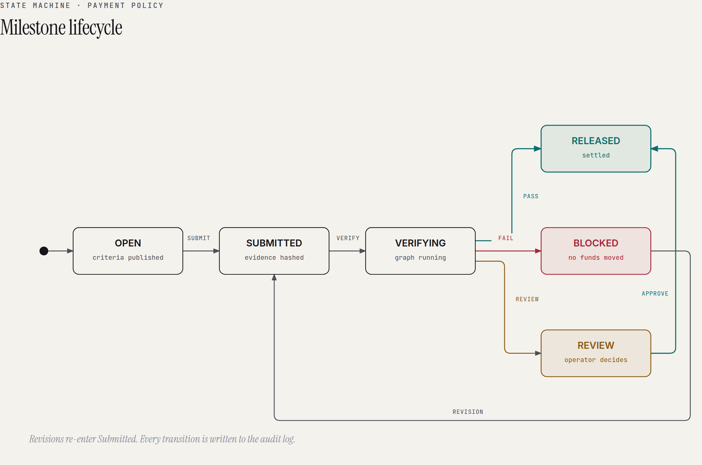

# Tranche

**Pay when it's proven.**

Tranche turns a milestone rubric into an executable acceptance graph, verifies a
builder's evidence node by node, asks SERV Reasoning for judgment and Reppo for
an independent verdict, and releases the tranche through a payment rail only
when the proof passes.

Built for **SERV Hackathon 02** — Kite track. Deadline: November 15, 2026.

- **Live demo:** <https://tranche-serv.fly.dev>
- **Release room:** <https://tranche-serv.fly.dev/console/>
- **Blocked-payment demo:** <https://tranche-serv.fly.dev/milestone/?id=ms_blocked>
- **Live blocked receipt:** <https://tranche-serv.fly.dev/receipt/?slug=afbq4eejfzhb>
- **Live released receipt:** <https://tranche-serv.fly.dev/receipt/?slug=sz8xmpe69pdr>
- **Repository:** this repository (public at submission time)

The public demo scales to zero when idle. The first request can take 5–10 seconds
while the machine resumes; refresh once if the proxy returns a cold-start error.
The release room retries its own API reads.



---

## 1. What it is

A grant program, bounty board, hackathon, or agent marketplace publishes a
milestone. The operator writes the acceptance criteria in plain English and sets
a tranche amount plus an auto-release ceiling. Tranche compiles that rubric into
typed nodes **before work starts**:

- **Script nodes** check facts as ordinary Rust code: repository visibility,
  README terms, demo reachability, commit recency, hashes. No model cost.
- **Agent nodes** handle the part that needs judgment. SERV Reasoning receives
  the claim, the evidence, and the deterministic results, with `serv_prompt_guard`
  and `serv_shadow_agent` enabled.
- **External nodes** request an independent verdict from Reppo's Evaluation API.
- **The policy gate** is code, not a model call. It combines the script results,
  both verdicts, the assurance level, and the operator's ceiling. A model cannot
  override a failed script. A blocked payment cannot be approved.

When a tranche passes, the settlement adapter releases it and a public **Proof
Receipt** records the graph version, graph hash, evidence hash, every node run,
both verdicts, and the settlement reference.

## 2. The problem

Agents can now hold an identity, carry a spending limit, and settle a payment in
seconds. The missing layer is not another wallet or another model. It is the
decision that comes before the payment:

> Did the work actually meet the criteria the funder published?

Today that decision is either a human reading a spreadsheet for a week or a model
saying "looks good" with no evidence. Both are expensive in different ways, and
neither produces a reusable record. Milestone-based funding platforms track
tranches, but the acceptance step is still manual. Agent payment rails enforce
*how much* an agent can spend, not *whether it should*.

## 3. The insight

SERV v3's Graph Sharding argues that a production reasoning process should split
into Script nodes (code), Decision nodes (calibrated models), and Agent nodes
(constrained LLM calls), with a predictable path and an audit trail. Acceptance
criteria have exactly that shape. Some checks are facts. Some are policy. Some
need judgment. A rubric should be compiled that way before money is committed.

Tranche applies the same discipline at the application layer on top of the public
SERV Reasoning API (v2). The graph is deterministic; SERV provides judgment
inside one node; Reppo provides a second, independent opinion; Rust owns the
release policy.

The product primitive is **payment conditioned on multi-layer proof**, not
"AI plus escrow."

## 4. The core workflow

1. **Operator publishes the graph.** Criteria, tranche, and ceiling are stored
   together. The builder can see exactly what will be checked and what each check
   costs.
2. **Builder submits evidence.** Repository URL, live demo URL, optional README
   URL, and a written claim. The evidence bundle is canonicalized and SHA-256
   hashed before any network call.
3. **Script nodes run.** Deterministic checks against GitHub and the public web.
   They return pass/fail with a visible reason.
4. **SERV judges.** A small model evaluates the claim against the criteria with
   PromptGuard on the inbound evidence and a Shadow Agent validating the verdict.
5. **Reppo verifies independently.** The full trace is submitted to Reppo's
   Evaluation API. A live lite evaluation returns a score, decision, confidence,
   and critiques.
6. **The policy gate decides.**
   - Any failed script, a SERV reject, or a live Reppo reject → **blocked**. No
     funds move. A receipt is issued.
   - Missing assurance, an unavailable verifier, or an amount above the ceiling →
     **review**. The payment is held for the operator.
   - Accepted, all scripts pass, assurance sufficient, amount at or below the
     ceiling → **release**. The settlement adapter runs.
7. **A Proof Receipt is published.** The receipt is the shareable artifact: it
   lets a builder prove the work passed and lets an auditor see why the money
   moved (or did not).

## 5. The demo (judge quickstart)

Open <https://tranche-serv.fly.dev/console/>. Four seeded milestones are available.

1. **Bounty — Kite Passport checkout** — click `Run seeded sample`. The demo URL
   returns 404. Script node 3 fails, SERV rejects, and the payment is stamped
   `BLOCKED` with `0.00 USDC` moved. Open the public receipt from the right rail.
2. **Reference build — proof-gated release** — click `Run seeded sample`. The
   repository, README, and demo checks pass; SERV accepts; the policy releases the
   tranche because the amount is at the auto-release ceiling. The receipt records
   the SERV verdict and the settlement reference. If SERV is not configured, the
   UI labels the verdict `FIXTURE` and holds the payment; if Reppo is unavailable,
   the UI labels it and assurance drops to medium.
3. **Grant tranche — independent review** — the same passing evidence, but the
   tranche is above the auto-release ceiling. The payment is held. Click
   `Approve release` to run the operator path; the receipt shows
   `review → released`.
4. **Bounty — hostile README** — a claim that contains instructions aimed at the
   reviewer. A deterministic safety node catches the reviewer-directed pattern
   before the policy can release, and the receipt records the marker without
   executing it. SERV and Reppo still run; their verdicts cannot override the
   failed safety check.

Every page labels the engine mode and the payment rail. Nothing simulated is
presented as live. The deployed demo runs SERV Reasoning **live** and Reppo
**live** (independent verdict); settlement is the labeled **demo ledger**. The
Kite Passport adapter is implemented with a passkey approval URL and a separate
status check; it requires the operator's passkey and a funded wallet to settle
for real.



### What is real vs. labeled

| Component | Status in this build | What that means |
|---|---|---|
| Script checks | **Real** | Live GitHub API and public HTTP requests; deterministic pass/fail; no model |
| Evidence hash | **Real** | SHA-256 over the canonical evidence bundle |
| Graph hash | **Real** | SHA-256 over the compiled acceptance graph |
| Structured verification trace | **Real** | Every node run persisted with status, detail, latency, and cost |
| Release policy | **Real** | Enforced in Rust; the model has no settlement authority |
| Public receipt | **Real** | Generated from the persisted trace; excluded from any mocked path |
| SERV Reasoning | **Live** when `SERV_API_KEY` is set | Calls `inference-api.openserv.ai` with PromptGuard + Shadow Agent. Without a key, a deterministic **fixture** evaluator runs and is labeled `FIXTURE`; fixture verdicts cannot release funds (`ALLOW_FIXTURE_RELEASE=false`). |
| Reppo Evaluation API | **Live lite** when `REPPO_CREDIT_TOKEN` is set | Submits the claim + evidence to `/api/v1/x402/evals`, polls for a settled verdict, and records score/decision/confidence/critique. Without a token, `sandbox` is a labeled advisory (no network call); without either, `unconfigured`. |
| Settlement | **Kite Passport** when `KITE_MODE=passport` and `KITE_PAYOUT_COMMAND` is set | Runs the configured Passport payout command with the amount, recipient, and reference. Otherwise the **demo ledger** is used; it records a settlement reference but makes no on-chain transfer, and the UI says `demo ledger`. |
| Seeded evidence | **Sample** | Public real URLs (`openserv-labs/sdk`, `openserv.ai/hackathon-2`), submitted as demo data; not a claim of authorship by the demo builder |

## 6. Hackathon relevance

**Track: Kite — agents with a verifiable identity and spending limits you control.**

Tranche is the acceptance layer for Kite-powered agent payments:

- The operator controls the tranche amount and the **auto-release ceiling**.
  Above the ceiling, a human must approve; a blocked payment can never be
  approved.
- The settlement adapter is the Kite Passport seam. In Passport mode,
  `scripts/kite_payout.sh` creates a `kpass wallet send` request and returns the
  passkey approval URL. The release room shows that link and a `Check approval`
  action; `KITE_STATUS_COMMAND=scripts/kite_status.sh` polls the signed send,
  records the transaction hash/explorer link, and only then marks the payment
  settled. A pending approval is never reported as settled.
- To turn on live settlement: install the Passport CLI, sign in and create a
  passkey, fund the Passport wallet, set `KITE_MODE=passport`,
  `KITE_PAYOUT_COMMAND=/app/scripts/kite_payout.sh`,
  `KITE_STATUS_COMMAND=/app/scripts/kite_status.sh`,
  `KITE_RECIPIENT_ADDRESS=<builder address>`, and set `OPERATOR_TOKEN`. Approve
  the held payment through the operator API/UI with the token.
- The demo uses the **ledger** rail because a real Passport session requires the
  operator's passkey and a funded USDC.e wallet. The UI never calls the ledger
  "Kite"; it says `demo ledger`. The Passport path is implemented as an adapter,
  not simulated inside the product.

**SERV Reasoning integration.** Every agent node uses the public SERV API with a
system prompt, low reasoning effort, structured JSON output, `serv_prompt_guard`,
and `serv_shadow_agent`. The UI shows the SERV engine, model, decision, score,
reasons, latency, and per-node cost. The graph itself is compiled in Rust; the
model does not choose which checks exist. The deployed demo runs this path live.

**Reppo integration.** The verification trace is submitted to the Reppo
Evaluation API as a `trace` with the milestone criteria. The returned score,
decision, confidence, critique, and eval id are persisted and shown separately
from SERV. Reppo is never used as decoration or as a second self-check.

**Judging criteria.**

- *Creativity:* an acceptance graph that is published before work starts and a
  payment that can be visibly refused.
- *User readiness:* a working operator console, a builder submission flow, a
  public receipt, and explicit failure states.
- *Revenue potential:* 1–2% of released tranches, or a per-verification fee.
  Every grant program, bounty board, and hackathon is a distribution channel.

## 7. Architecture



The system is deliberately small:

```
frontend/          Next.js 16, TypeScript, static export
backend/           Rust, Axum, Tokio, SQLx, SQLite
  src/api.rs       HTTP boundary, validation, operator approval
  src/executor.rs  acceptance graph executor, policy gate, receipts
  src/domain.rs    graph compiler, typed states, verdicts
  src/net.rs       public-URL validation, SSRF guards, redirect handling
  src/integrations SERV, Reppo, GitHub
  src/payments.rs  Kite Passport command adapter / demo ledger
docs/diagrams/     architecture and lifecycle diagrams
```

The frontend is a static export served by the Rust binary in production, so the
deployment is one process and one volume. In development, Next.js runs separately
and points at the Rust API.

### Acceptance graph

A compiled graph is a versioned JSON document:

```json
{
  "version": 2,
  "criteria": "The repository is public and its README documents SERV Reasoning...",
  "nodes": [
    { "id": "repo",  "kind": "script", "check": "repo_public", ... },
    { "id": "readme","kind": "script", "check": "readme_mentions", "tokens": ["serv"] },
    { "id": "demo",  "kind": "script", "check": "demo_url_live" },
    { "id": "safety","kind": "script", "check": "claim_safety" },
    { "id": "review","kind": "agent",  "check": "criteria_review" },
    { "id": "independent", "kind": "external", "check": "reppo_eval" }
  ]
}
```

The executor creates every node run before it starts, updates status as each
node completes, and writes the graph hash onto the receipt.

### Policy

The release policy is a pure function with unit tests:

```text
if any script failed            -> BOUNCE
if SERV rejected                -> BOUNCE
if Reppo rejected (live)        -> BOUNCE
if SERV asked for revision      -> REVIEW
if assurance is insufficient    -> REVIEW
if amount > auto-release ceiling-> REVIEW
otherwise                       -> RELEASE
```

`review` creates a held payment; only an operator can approve it. `bounce`
creates a blocked payment that cannot be approved.

### Data model

| Table | Purpose |
|---|---|
| `programs` | A funding program |
| `milestones` | Criteria, graph JSON, amount, ceiling, state, sample data |
| `submissions` | Canonical evidence bundle + SHA-256 |
| `node_runs` | One row per graph node with status, detail, latency, cost, output |
| `verdicts` | SERV verdict, Reppo verdict, assurance, final decision |
| `payments` | Rail, status, reference, explorer link, operator note |
| `receipts` | Public slug per released/blocked submission |
| `events` | Operator-readable audit log |

## 8. Running locally

### Prerequisites

- Rust stable (1.85+; the project was built with 1.97 nightly)
- Node.js 22+
- pnpm 11+
- A public GitHub repository and a public demo URL for manual testing

### Install

```bash
git clone <repository-url> tranche
cd tranche
cp backend/.env.example backend/.env
make install
```

Edit `backend/.env`:

```dotenv
SERV_API_KEY=...              # required for live judgment
REPPO_CREDIT_TOKEN=...        # required for live independent verdicts (x402 prepaid credits)
GITHUB_TOKEN=...              # optional: raises GitHub rate limits
KITE_MODE=ledger              # demo ledger; use passport + a payout command for live
ALLOW_FIXTURE_RELEASE=false   # keep false; a simulated verdict must not release funds
```

If `SERV_API_KEY` is absent the app still runs; the UI labels the verdict
`FIXTURE`, the assurance is `low`, and a release is held for human review.

### Development

Terminal 1:

```bash
make dev-backend
# http://127.0.0.1:8080
```

Terminal 2:

```bash
make dev-frontend
# http://127.0.0.1:3000
```

The example frontend environment points the browser at `http://127.0.0.1:8080`.
Copy `frontend/.env.example` to `frontend/.env.development` if you need a
different API base. If port 8080 is taken, change `BIND_ADDR` in `backend/.env`
and `NEXT_PUBLIC_API_BASE` in `frontend/.env.development`.

### Production / single binary

```bash
make build
cd backend
FRONTEND_DIR=../frontend/out BIND_ADDR=0.0.0.0:8080 ./target/release/tranche
```

Or:

```bash
docker build -t tranche .
docker run --rm -p 8080:8080 -v "$PWD/data:/data" tranche
```

### Tests

```bash
make test
```

- Rust: graph compilation, state transitions, release policy, fixture evaluator,
  Reppo response parsing, GitHub URL parsing, SSRF address blocking.
- TypeScript: strict typecheck.

### Reset the demo

```bash
make reset-demo
```

Restart the backend to reseed the four milestones.

## 9. Security and reliability

- **Untrusted evidence.** Claims and README text are treated as data. SERV
  PromptGuard screens inbound content, a Shadow Agent validates the verdict, and
  the claim is never executed.
- **Model authority is bounded.** The model cannot create payment instructions.
  The policy gate is a pure Rust function with failing tests for the dangerous
  cases.
- **Blocked payments cannot be approved.** The approval endpoint refuses a
  `blocked` payment and re-checks the verdict.
- **SSRF protection.** Public evidence URLs are validated for scheme, credentials,
  host, and resolved IP; redirects are followed manually with the same checks; the
  body is capped. Loopback, private ranges, link-local, and metadata hosts are
  rejected.
- **Input limits.** Claims are capped at 4,000 characters, URLs at 2,048, tranches
  at 100,000 USDC in the demo. SQL is parameterized.
- **Secrets stay server-side.** `SERV_API_KEY`, `REPPO_CREDIT_TOKEN`,
  `GITHUB_TOKEN`, and `KITE_PAYOUT_COMMAND` are never sent to the browser.
- **Operator token.** If `OPERATOR_TOKEN` is set, approving a held payment
  requires `X-Operator-Token`. Use this whenever `KITE_MODE=passport`.
- **Idempotency.** A submission is verified once; a payment row is created once
  per verdict; approval refuses an already-settled payment.
- **Failure behavior.** An unavailable reasoning engine lowers assurance and
  routes to review. A failed settlement keeps the payment held and records the
  reason. A failed verification leaves the milestone in `needs_review`, never
  `released`.
- **Known demo limitations.** The public demo has no user auth or tenancy, uses a
  single SQLite volume, and does not rate-limit requests. These are deployment
  concerns for production, not claims that the demo is safe for real funds.

## 10. Limitations and roadmap

### Current limitations

- **Kite Passport** has no public HTTP API yet; the integration is a CLI payout
  adapter. A native session-creation flow with passkey approval is the next step.
- **Reppo lite** costs 440 credits per evaluation (about $0.22) and needs a
  funded Base wallet. The public demo runs it live; the settlement window is
  usually 30–90 seconds, so the payment is held if the verdict has not settled.
- **SERV v3 Graph Sharding** is in beta. Tranche applies the script/decision/agent
  split at the application layer on the public v2 API; it does not claim to call
  a v3 graph endpoint.
- Evidence is limited to public URLs and text. There are no file uploads, private
  repositories, or cryptographic signatures from the builder.
- The demo ledger is not on-chain. The receipt labels it as a ledger reference.
- The verifier can check whether a claim is supported by public evidence; it
  cannot prove authorship or judge subjective quality beyond the published
  criteria.

### Roadmap

1. Native Kite Passport session creation, passkey approval, and per-tranche
   session caps in the UI.
2. Pre-settled or standard Reppo evaluations for offline demos, with an explicit
   settlement window.
3. Multi-milestone programs with cumulative caps and a portfolio view.
4. Builder proof records: portable receipts that work across programs.
5. A small escrow contract for trust-minimized custody, with the same policy
   gate authoritative off-chain.
6. Dolphin extraction nodes for large evidence bundles where cheaper inference
   materially improves the cost per verdict.

## 11. Submission artifacts

- `docs/submission/checklist.md` — submission and eligibility checklist.
- `docs/SECURITY.md` — threat model, controls, and residual risks.
- `docs/submission/writeup.md` — short write-up for the submission form.
- `docs/submission/x-post.md` — public X post draft.
- `docs/submission/demo-script.md` — 2–3 minute demo script.
- `docs/diagrams/architecture.html` and `state-machine.html` — editable diagrams.
- `docs/diagrams/*.png` — exported diagrams used above.

## 12. License

MIT. See `LICENSE`.
